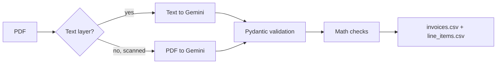

# Invoice Extractor

[](https://github.com/KwagFN/invoice-extractor/actions/workflows/ci.yml)

Turns a folder of PDF invoices into clean spreadsheets with AI, then double-checks the math, so mistakes get flagged instead of silently copied.

**AI reads, code verifies.** Language models are great at reading messy documents, and occasionally wrong about a digit. This project uses Gemini to extract the data and plain Python to check that every line, subtotal and total adds up. Invoices that don't add up are marked for human review.

## Results on the sample invoices

`samples/` holds four fictional invoices with different layouts, languages, currencies and date formats. One of them has a total that is 10.00 too high on purpose.

| File | What makes it different | Status | Details |
|---|---|---|---|
| `acme_INV-1001.pdf` | English table, USD, date "October 15, 2026" | OK | |
| `northwind_NW-2045.pdf` | English table, EUR, date "2026-10-20" | OK | |
| `padaria_FAT-0789.pdf` | Portuguese list, BRL, amounts like "R$ 815,54", date "28/10/2026" | OK | |
| `bluesky_INV-3310.pdf` | English table, USD, date "Nov 1, 2026" | NEEDS REVIEW | Subtotal + tax = 277.88, but total is 287.88 |

On a real run, every extracted value (invoice numbers, dates, parties, currencies, all 10 line items and every total) matched the values used to generate the invoices, and the deliberate error was caught.

## How it works



- **Structured output.** The model must answer with JSON that follows a schema generated from Pydantic models. Field descriptions double as instructions for the model (for example, "ISO 4217 code, e.g. USD, EUR, BRL").
- **Two layers of validation.** Pydantic checks types and formats (real dates, 3-letter currency codes, positive quantities) and converts amounts to `Decimal`. Then `find_issues` checks the math: quantity × unit price for every line, sum of lines = subtotal, subtotal + tax = total, with a one-cent tolerance for rounding.
- **The AI is told not to fix anything.** It must copy values exactly as printed. Otherwise it could "correct" a wrong total and hide the very error the checks are there to catch.
- **Scanned PDFs.** When a PDF has no text layer, the file itself is sent and Gemini reads the pages.
- **Batch-safe.** A broken file is logged and reported as `FAILED`, and the rest of the batch keeps going. The command exits with code 1 when any file fails, so schedulers and CI notice.
- **Rate limits.** Requests that hit a rate limit (429) or a server error are retried with exponential backoff, and there is a pause between files.
- **Provider-agnostic.** The pipeline depends on an `InvoiceExtractor` protocol, not on Gemini. Adding Claude or OpenAI means writing one class with the same two methods.

## Output

| File | One row per | Columns |
|---|---|---|
| `output/invoices.csv` | invoice | file, status, details, invoice number, issue date, vendor, customer, currency, subtotal, tax, total |
| `output/line_items.csv` | line item | file, invoice number, description, quantity, unit price, amount |

The two files are linked by `file` and `invoice_number`. Status is `OK` (read and consistent), `NEEDS REVIEW` (read, but the numbers don't add up; `details` says where) or `FAILED` (could not be read; `details` has the error). Files are UTF-8 with BOM, so accents display correctly in Excel.

## Running it

Requires [uv](https://docs.astral.sh/uv/) and a Gemini API key from [Google AI Studio](https://aistudio.google.com/).

```bash
git clone https://github.com/KwagFN/invoice-extractor.git
cd invoice-extractor
uv sync
cp .env.example .env   # then set GEMINI_API_KEY in .env
uv run invoice-extractor samples
```

```
usage: invoice-extractor [-h] [--output OUTPUT] [--delay DELAY] folder
```

The model defaults to `gemini-3.5-flash-lite` and can be changed with `GEMINI_MODEL` in `.env`.

Other scripts:

- `uv run python scripts/make_samples.py` regenerates the sample invoices.
- `uv run python scripts/try_extraction.py samples/acme_INV-1001.pdf` runs the AI on a single file and prints the result.

> **Privacy note.** On the Gemini API free tier, Google may use submitted content to improve its products. That is fine for the fictional samples in this repository. For real documents, use a paid tier or another provider.

## Tests

```bash
uv run pytest -v
uv run ruff format --check .
uv run ruff check .
```

The 26 tests need no API key and no internet access:

- A fake AI client records each request, so the tests check what is sent to the model (text or PDF, schema, instructions) without calling it.
- Invalid or empty AI responses must raise a clear error.
- Pipeline tests cover consistent invoices, invoices that need review, scanned PDFs, a corrupted file in the middle of a batch, and the pause between files.
- The CSV reports are written and read back.

## Project structure

```
src/invoice_extractor/
├── __init__.py    # command line entry point
├── ai.py          # Gemini extractor, retries, extractor protocol
├── models.py      # Invoice and LineItem (Pydantic)
├── validation.py  # math checks
├── pdf_text.py    # text layer extraction
├── pipeline.py    # folder → results, one file at a time
└── report.py      # CSV output
scripts/           # sample generator, single-file runner
samples/           # fictional invoices
tests/
```

## What I would add next

- Claude and OpenAI extractors behind the same protocol
- Google Sheets output
- An accuracy report that compares each extraction with the known values of the samples
- Discounts and shipping lines in the math checks
